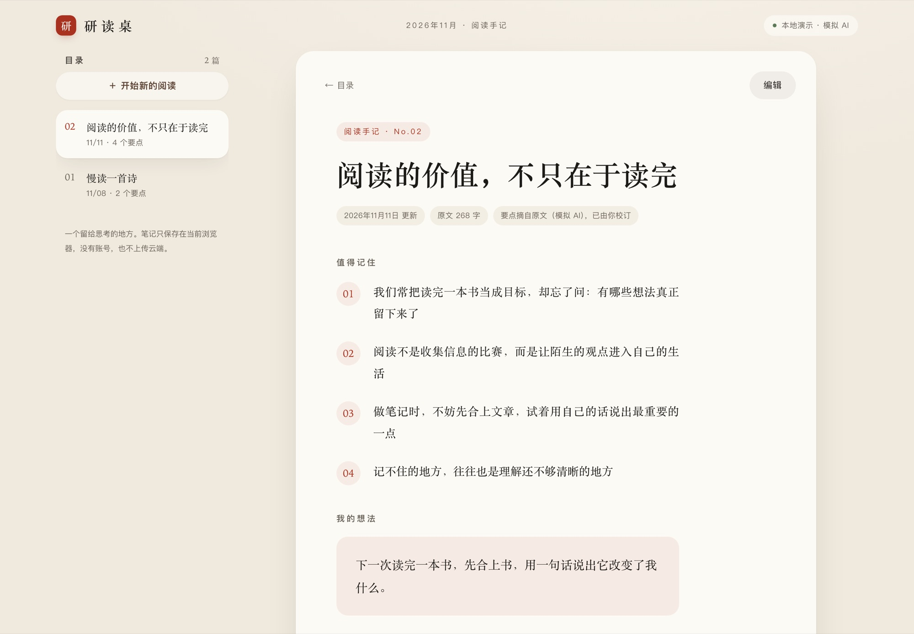
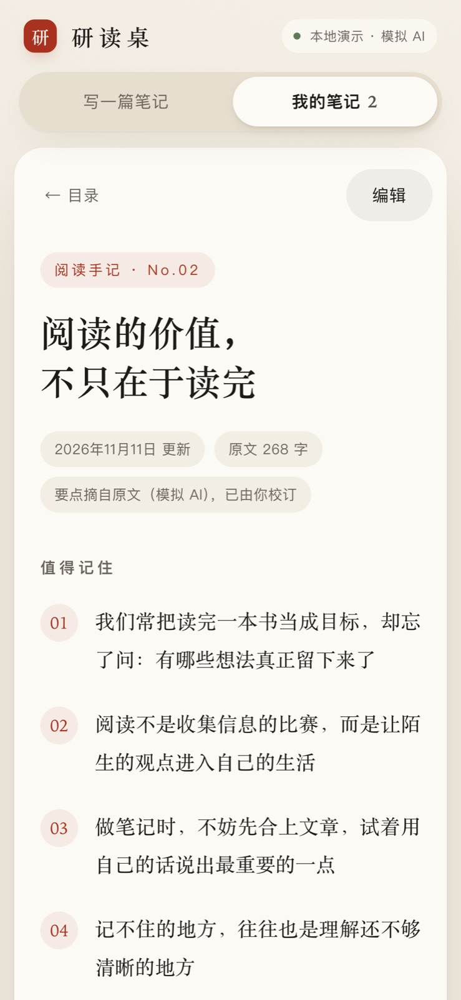
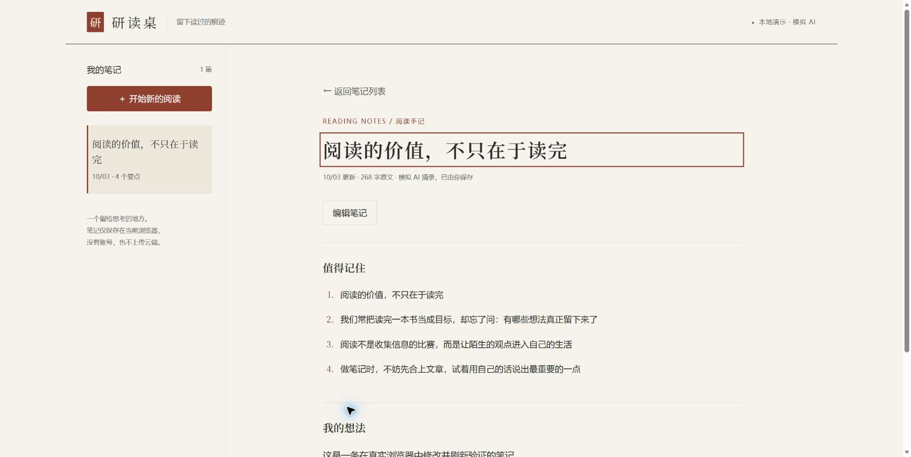
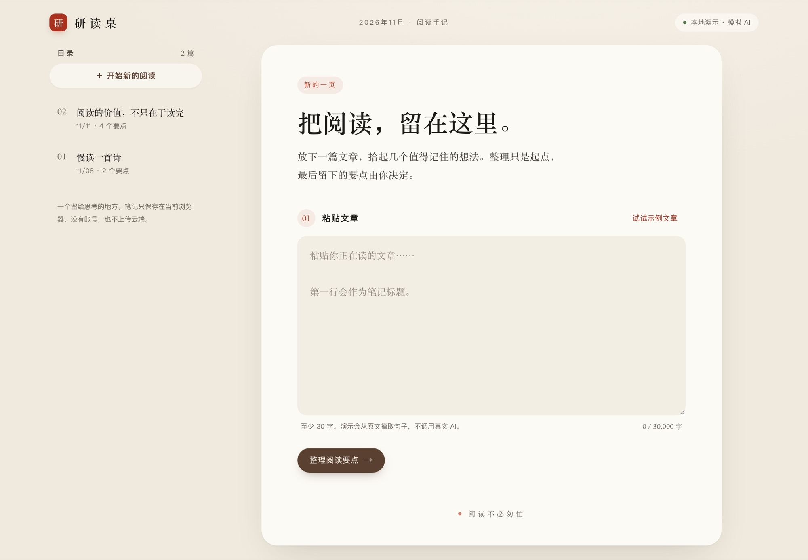
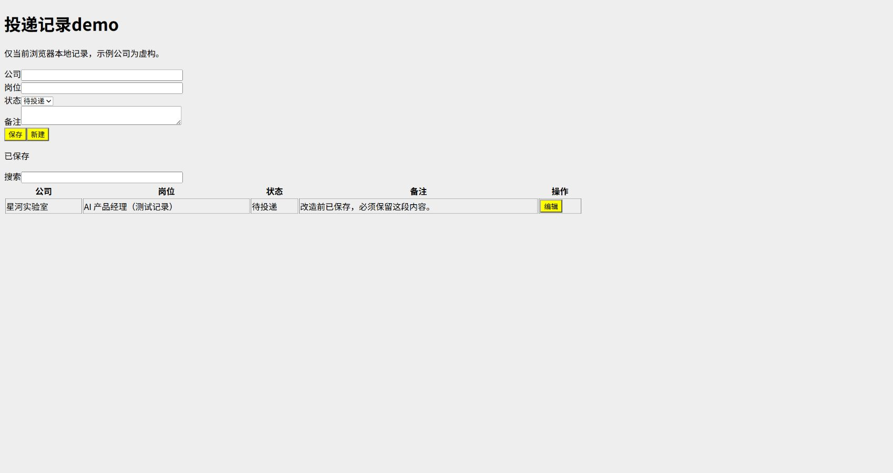
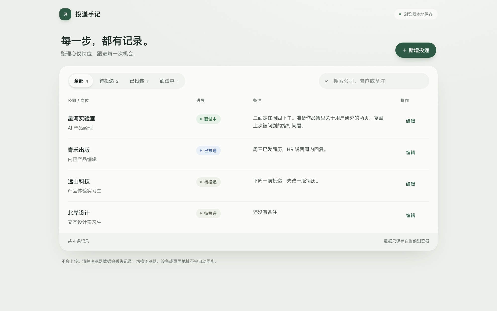
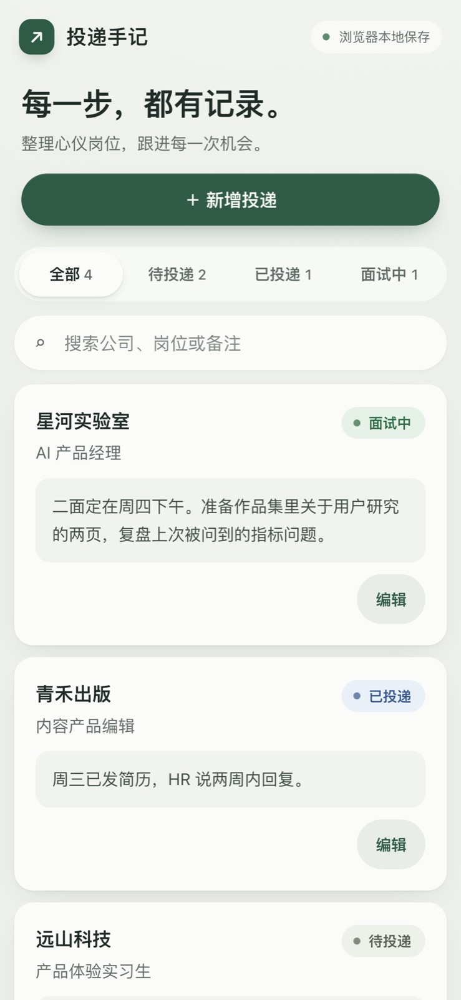

# Codex UI Designer Kit

### 说清楚你想做什么，设计判断交给 Skill。

让没有设计经验的人，通过 Codex 把产品想法或粗糙 demo 做成一套清楚、一致、可操作的页面。

你不用先懂字体搭配、栅格、骨架屏或转场术语。描述用户、任务与想要的感觉，Kit 会引导 Codex 规划页面、选择视觉方向、实现交互，再通过真实页面检查迭代。

[看案例](#三个案例) · [开始使用](#开始使用) · [Skill入口](SKILL.md) · [验证记录](docs/showcase-validation.md)



> **当前阶段：候选版。** 两个页面案例都按[视觉纠偏手册](references/visual-taste-corrections.md)完成了一轮精修，研读桌经过三轮真人反馈。案例里的 AI 是本地模拟。新版 Skill 能否让 Codex 一次生成到这个水平，还需要重新跑一遍验证。

## 它能帮你做什么

| 你现在的情况 | 交给 Kit 的输入 | Codex 应交付什么 |
|---|---|---|
| 只有一个产品想法 | 谁用、要完成什么、想要什么感觉 | 必要页面、统一视觉规范、可运行主流程 |
| 已经有一个小 demo | 现有代码或运行入口、哪里不好用 | 保留原行为与数据的改造，以及前后对比 |
| 只想调整一个区域 | 指定页面或组件、期望变化 | 沿用现有设计系统的局部优化 |
| 说不出效果的名字 | “生成时别空着”“详情别突然跳出来” | 白话解释、适合的方案，必要时提供比较样例 |

它把**设计判断、代码实现、真实验收**串在一起。已有组件和技术栈优先复用，不强制迁移到特定前端框架。

## 三个案例

这三例分别验证不同能力：从零新建、改造已有 demo、讨论说不出名字的效果。

### 01 · 研读桌：从想法到阅读产品

> “我没有设计经验，希望像一本安静的杂志。粘贴文章后整理要点，能保存、查看和编辑；电脑手机都能用。”

<table>
<tr><td width="72%"></td><td width="28%"></td></tr>
<tr><td>桌面：目录与阅读</td><td>手机：聚焦当前内容</td></tr>
</table>

- **设计判断**：书桌上的一页纸。层级靠“桌面 → 纸页 → 内凹面”三层面和留白区分，不用分割线；阅读内容统一用宋体，朱红只用于印章、序号和当前位置，主操作用与纸同色相的胡桃褐。
- **实际流程**：粘贴 → 模拟整理 → 校订 → 保存 → 列表 → 详情 → 编辑。
- **交互细节**：等待反馈、取消、原文保留、刷新读回、保存失败保留输入、轻转场及减少动态效果。

**这一版是怎么改出来的。** v1 由 Kit 首次生成，功能完整，但满屏细线、直角、红色用在太多地方。之后按真人反馈改了三轮：先统一阅读字体、修掉标题被重复摘成要点和宽屏偏左；再按“不喜欢线框感和直角”改成纸页与圆角；最后按“牛皮纸背景上放黑按钮有点怪”把主按钮换成胡桃褐。每轮的问题、改法和规则已整理进[视觉纠偏手册](references/visual-taste-corrections.md)，供 Codex 下次生成前读取。

<details>
<summary>对比 v1 与 v2 新建页</summary>
<br>
<table>
<tr><td width="50%"></td><td width="50%"></td></tr>
<tr><td>v1：线框分区，强调色过多</td><td>v2 新建页：一屏一个主操作</td></tr>
</table>
</details>

[查看源码与运行方法](examples/reading-desk/) · [设计记录](examples/reading-desk/DESIGN.md) · [首轮验证与修复](docs/showcase-validation.md#1-研读桌从一句需求开始)

### 02 · 投递手记：把能跑的 demo 改成日常工具

> “功能能跑，但像作业。希望变成每天能用的产品，保留原数据和新增、编辑、搜索功能。”

<table>
<tr><td width="50%"></td><td width="50%"></td></tr>
<tr><td>改造前：功能直接堆在一页</td><td>改造后：按记录和操作组织界面</td></tr>
</table>

- **保留**：原数据键、字段，以及新增、编辑、搜索、保存能力。
- **改善**：列表优先、按需编辑、状态筛选；手机转为记录卡片，失败时保留输入。
- **视觉**：记录行之间保留极淡行线，因为要逐行比较；其余分区去掉线，改用留白和底色面。主操作用和背景同色相的深松绿，筛选改为分段胶囊。和研读桌同一套方法，结果不同，因为一个是阅读产品，一个是数据工具。
- **验证**：先在旧页创建记录，再用新版打开、修改、刷新，确认数据继承与保存。

<details>
<summary>查看手机布局</summary>
<br>

</details>

[查看改造前后源码](examples/application-tracker/) · [设计记录](examples/application-tracker/DESIGN.md) · [首轮验证与修复](docs/showcase-validation.md#2-投递手记保留功能与数据的改造)

### 03 · 效果体验室：把感觉变成可讨论的设计

> “我不知道这个效果叫什么，但想让它自然一点。”

用同一份内容比较等待反馈、详情切换、排版密度和保存反馈。讨论的是何时使用、怎样帮助任务、有哪些取舍，再决定实现方式。

这是固定交互演示；理解自然语言与推荐方案由 Codex + Skill 完成。体验室本身没有接入模型。

[查看效果体验室](examples/effect-studio/) · [设计对话方法](references/design-dialogue.md) · [效果场景索引](references/effect-patterns.md)

## 开始使用

### 先体验案例

获取仓库后，在根目录执行以下命令（需要 Python）：

```bash
python -m http.server 8000 --bind 127.0.0.1
```

在浏览器打开：

- 研读桌：`http://127.0.0.1:8000/examples/reading-desk/`
- 投递手记：`http://127.0.0.1:8000/examples/application-tracker/`
- 效果体验室：`http://127.0.0.1:8000/examples/effect-studio/`

GitHub 文件页展示源码，不会直接运行这些 HTML。案例无需前端构建；数据只保存在当前浏览器，不跨设备同步。

### 再用到自己的项目

把本仓库放到 Codex 能读取的位置，指定 `SKILL.md` 和你的目标工程。无需先安装全局 Skill，也无需提供设计术语。

**从零新建**

```text
请读取 UI Designer Kit 的 SKILL.md，在我的项目中做一个阅读笔记工具。
用户粘贴文章后可以整理、修改和保存要点，手机也能用。
我希望像一本安静的杂志。先用本地模拟数据实现，说明设计选择并验证主流程。
```

**已有改造**

```text
请按 UI Designer Kit 改造这个 demo。保留已有数据与功能。
现在输入、结果和操作挤在一起，我不知道怎么整理。
请先检查运行入口和现有行为，再调整布局、反馈与手机适配，交付前后对比。
```

## Skill 如何工作

```text
理解用户与任务 → 规划页面和主流程 → 选择视觉方向
→ 做代表页 → 扩展页面与状态 → 浏览器检查 → 修复并交付
```

1. **承担设计判断**：从口语需求推导内容优先级、排版、分组和响应式变化。
2. **按需选择效果**：先解释体验与取舍，再给术语；动效对应真实状态，不虚构进度。
3. **实现任务闭环**：除了成功画面，还处理空态、校验、失败恢复、取消和保存。
4. **实际验证**：检查页面、关键交互和多种宽度，记录问题并聚焦修复。

交付应包含可运行代码、启动说明、简短设计记录，以及已验证与未验证项。

## 资源导航

| 资源 | 用途 |
|---|---|
| [产品设计流程](references/product-design-workflow.md) | 页面规划与主任务闭环 |
| [设计基础](references/design-foundations.md) | 视觉第 1 步：内容层级、排版、间距与响应式 |
| [视觉语言推导](references/visual-design-derivation.md) | 视觉第 2 步：从产品定位推出风格命题 |
| [真实产品视觉基准](references/product-visual-benchmarks.md) | 视觉第 3 和第 6 步：按任务选参照，逐项验收精修质量 |
| [项目设计契约](references/project-design-contract.md) | 视觉第 4 步：把方向写成 tokens、组件和状态规格 |
| [视觉纠偏手册](references/visual-taste-corrections.md) | 视觉第 5 和第 6 步：Agent 默认审美问题、截图复查顺序、两个案例的改版记录 |
| [产品调研与样例复评](docs/product-benchmark-research.md) | 官方来源、可见观察、证据边界和现有差距 |
| [交互契约](references/interaction-contracts.md) | 输入保留、错误恢复、焦点与用户控制 |
| [Recipes](recipes/) | SaaS、CRM、AI工作台、看板、移动笔记五类场景 |
| [Pattern registry](patterns/registry.json) | 十个布局、内容和状态模式的选择入口 |
| [设计模板](templates/DESIGN.md) | 把选择落实为可实现的规格 |
| [质量与证据](references/product-quality.md) | 区分代码检查、浏览器结果与真人评价 |
| [截图QA运行说明](examples/ugly-saas-dashboard/QA_RUNBOOK.md) | 自动截图和机械检查的前提与限制 |

Recipe 和 pattern 提供设计指导与结构示意，部分组件需要自行实现。案例是特定任务的实现，不能直接代表所有产品类型。

## 验证与边界

两个页面案例都在浏览器里走过主流程、保存刷新、保存失败，并检查了 1440 / 768 / 375 宽度；`verify.cjs` 和仓库测试通过。过程见各案例的 `DESIGN.md` 和[案例验证说明](docs/showcase-validation.md)。

还没有验证的：真实 AI 输出质量、完整无障碍、真实手机软键盘、生产环境，以及新版 Skill 让 Codex 从零生成时能否达到同样效果。案例使用模拟数据，不含客户资料。

## 来源与复用

设计规则参考公开设计系统与交互资料，链接见[案例说明](docs/showcase-validation.md#资料依据)；pattern 的来源与适配范围记录在各自 `source-map.json`。

复用第三方组件时，应核对所选版本的许可。引用设计原则不等于拥有组件代码、字体、图片或品牌资产的再分发权。
